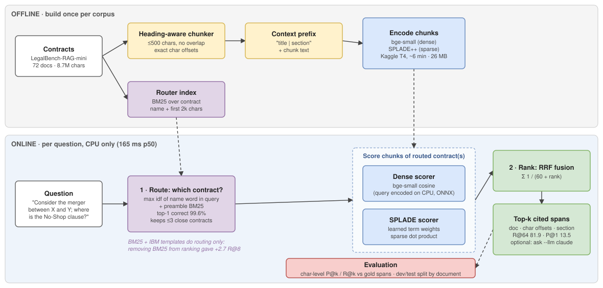

# Problem 2.2: Blended RAG for Contract Review

**Find the exact clause that answers a question about a specific contract, on a laptop CPU.** A lawyer asks "Where is the No-Shop clause in the BridgeBio / Eidos merger agreement?" and needs the passage itself, with a citation. This repo rebuilds IBM's [Blended RAG](https://arxiv.org/abs/2404.07220) (BM25 + dense + learned-sparse retrieval, multi-field query templates, fusion) without Elasticsearch, as a two-stage retriever: **route to the contract, then rank its clauses.**

| Headline, LegalBench-RAG-mini (776 questions, 72 contracts) | Ours | Paper's baseline (OpenAI `text-embedding-3-large`) |
|---|---|---|
| R@64: share of the answer's characters in the top 64 chunks | **81.9%** | 62.2% (recursive chunks) / 76.4% (naive chunks) |
| P@1: share of the top chunk's characters that are answer | **13.5** | 6.4 |
| Hardware / latency | **CPU only, 165 ms p50** per query | hosted embedding API |



The write-up (problem, design decisions, setup, evaluation, trade-offs) is in [docs/](docs/README.md).

## Run

Requires Python 3.10+. The commands below are the ones in [run.yaml](run.yaml). The whole sequence takes about 6 minutes on a 4-core laptop CPU, most of it the model download and encoding the questions.

```bash
pip install -r requirements.txt
python src/main.py download                  # two ONNX models, ~650 MB (no data download: the corpus is committed)
python src/main.py index                     # loads the committed chunk vectors, ~2 s
python src/main.py evaluate --configs default   # results table -> artifacts/results/mini.default.md
python src/main.py search "Consider the Acquisition Agreement between Parent 'BridgeBio Pharma, Inc.' and Target 'Eidos Therapeutics, Inc.'; Where is the No-Shop Clause" -k 3
pytest -q                                    # 35 tests, offline
```

No GPU or API key is needed. Optional: `python src/main.py ask "<question>" --llm claude` writes a cited answer from the retrieved spans through a local `claude` CLI, if one is installed. The full ablation (`evaluate --configs core`) needs the other chunkings' vectors: run [kaggle/encode.py](kaggle/README.md) on a free GPU (~6 min), or add `--allow-encode` to encode them on the CPU (~45 min each).

## How it works

1. **Chunk.** Contracts are cut at section headings into pieces of at most 500 characters, with no overlap. Each piece keeps its exact character offsets, so every result is a citation. Each chunk is encoded with a `contract title | section heading` prefix, so it carries its context.
2. **Route.** A contract's score is the *rarest* question word found in its name, plus BM25 over its first 2,000 characters, where the parties are named. Max-pooling lets one distinctive name ("Kenway") beat generic words ("non-disclosure agreement") that match every NDA. Routing is 99.6% top-1 correct.
3. **Rank.** Inside the routed contract, `bge-small-en-v1.5` (dense) and `SPLADE++` (sparse, in place of IBM's ELSER) rank the chunks. Reciprocal rank fusion merges the two rankings without score calibration.
4. **Return** the top-k spans: document, character offsets, section heading, text.

## Results

The 776 questions are split **by document** into dev (235) and test (541). The default config was chosen on dev; the table is test. Recall and precision are measured in characters and averaged over the four sub-datasets.

| Test, 541 questions (%) | P@1 | R@8 | R@64 | Contract @1 |
|---|---|---|---|---|
| BM25, plain `match` | 2.5 | 10.1 | 30.8 | 76.1 |
| BM25, IBM `most_fields` (text + title) | 2.9 | 16.2 | 61.1 | 86.0 |
| Dense, naive 500-char chunks, no context | 3.3 | 17.8 | 43.0 | 77.3 |
| Dense | 11.4 | 35.6 | 75.3 | 95.0 |
| SPLADE | 13.3 | 30.1 | 75.4 | 94.3 |
| IBM's blend: SPLADE + BM25, raw score sum | 8.3 | 29.9 | 75.0 | 94.1 |
| RRF: BM25 + dense + SPLADE | 9.7 | 33.9 | 79.0 | 95.2 |
| + routing | 10.8 | 38.0 | 82.5 | 99.4 |
| **+ routing, without BM25 in the ranking (default)** | **14.4** | **40.6** | **82.0** | **99.4** |

**What the ablation shows:**
- **Chunk context is the biggest single gain.** Heading-aware chunks with a `title | section` prefix lift dense R@64 from 43.0 to 75.3.
- **BM25 belongs in routing, not ranking.** IBM's title-aware template doubles BM25 recall (30.8 → 61.1), because naming the contract is most of the problem. Once a router does that, removing BM25 from the ranking gains +2.7 R@8 (paired bootstrap, p = 0.002).
- **Dense carries the ranking; SPLADE adds precision.** Removing dense costs 4.8 R@8. SPLADE matches dense alone on R@8 (40.6 vs 40.9, within the CI) and adds +1.2 P@1.

**Reading the numbers:**
- **Why P@1 looks low:** it is *character* precision. A 500-character chunk against an answer of about 330 characters cannot score near 100%. Even retrieving exactly the chunks that overlap the answer scores about 70%.
- **The paper comparison:** same split, same metric definition. Two differences, both stated up front:
  - the paper's baseline has no routing, so most of the gap comes from the design, not from better embeddings;
  - our scorer merges overlapping retrieved spans, where upstream double-counts them, so our recall is never inflated.

The full ablation (leave-one-out, chunking, 95% bootstrap CIs, per-dataset numbers) is in [artifacts/results/mini.core.md](artifacts/results/mini.core.md).

**Cost:** 165 ms p50 / 198 ms p95 per question on an i5-10210U, including question encoding; 0.95 GB peak RAM; 26 MB of committed vectors.

## Limitations

- **Every benchmark question names its contract,** which makes routing easy. A product needs a contract picker or a "which contract?" follow-up.
- **MAUD merger agreements are still the weak spot** (R@64 48%): long clauses span several chunks.
- **Only the mini split is evaluated,** and only retrieval: answer quality is not scored.

More in [docs/](docs/README.md#7-limitations).

## Repository layout

| Path | Contents |
|---|---|
| `run.yaml` | the exact grader commands |
| `src/main.py` | CLI: `download`, `index`, `search`, `ask`, `evaluate`, `benchmark` |
| `src/blended_rag/data.py` | LegalBench-RAG loading, exact mini split, dev/test split by document |
| `src/blended_rag/chunking.py` | heading-aware chunker with exact offsets |
| `src/blended_rag/indexes/` | multi-field BM25, dense, SPLADE indexes |
| `src/blended_rag/queries.py` · `fusion.py` | IBM query templates · RRF, weighted sum, IBM score sum |
| `src/blended_rag/routing.py` · `pipeline.py` | contract router · retriever: route → score → fuse → cited spans |
| `src/blended_rag/encode.py` | CPU (ONNX) and GPU (torch) encoders, fingerprinted vector cache |
| `src/blended_rag/metrics.py` · `evaluate.py` | character-level P/R@k, MRR, nDCG, bootstrap CIs · ablation configs |
| `kaggle/` | GPU encoding script; a parity check confirms GPU and CPU encoders agree (cosine ≥ 0.99999) |
| `data/mini/` · `artifacts/` | committed corpus and questions · chunk vectors, results tables, CPU benchmark |
| `docs/` · `tests/` | write-up and architecture diagram · 35 tests, including an offline end-to-end run |

## Data and credits

- **LegalBench-RAG** (Pipitone & Houir Alami, 2024), built from CUAD, MAUD and ContractNLI (CC BY 4.0) and PrivacyQA. `data/mini/` is the mini subset, selected exactly as in the authors' `benchmark.py`.
- **Blended RAG** (Sawarkar et al., IBM, 2024): the method.
- **Models:** `BAAI/bge-small-en-v1.5` and `prithivida/Splade_PP_en_v1`, run through `fastembed` (ONNX).
