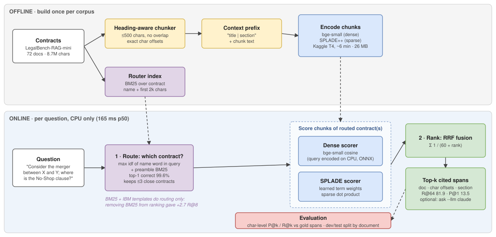

# Blended RAG for Contract Review: Write-up

**In short:** we rebuilt IBM's Blended RAG as a CPU-only, two-stage retriever: find the contract, then find the clause. On LegalBench-RAG-mini (776 legal questions with character-exact answers) it retrieves 81.9% of the answer text in the top 64 chunks. The benchmark authors' OpenAI-embedding baseline retrieves 62.2%. A query takes 165 ms on a laptop CPU. How to run it: [root README](../README.md).

## 1. Problem

**Task: contract review.** A lawyer asks about one specific agreement ("Where is the No-Shop clause in the BridgeBio / Eidos merger?") and needs the exact passage, with a citation.

**Why it's hard:**
- every NDA has a confidentiality clause, so contracts look alike;
- questions mix exact legal terms with paraphrases;
- a merger agreement averages about 350k characters, while the answer is about 330.

**Brainstorming → solution.** Plain dense RAG finds the right *kind* of clause in the *wrong* contract. So we split the problem into (1) which contract, then (2) which clause. Blended RAG fits the second step: exact-word search (BM25), meaning search (dense) and learned keyword expansion (SPLADE) each catch questions the others miss. IBM's code needs Elasticsearch and its licensed ELSER model, so we kept the method and rebuilt it in-process with open models.

## 2. Data

**LegalBench-RAG** (Pipitone & Houir Alami, 2024) has four sub-datasets: CUAD (commercial contracts), MAUD (M&A), ContractNLI (NDAs) and PrivacyQA. Answers are character spans, so scoring is exact and needs no LLM judge.

We use the **mini** subset: 776 questions over 72 documents (8.7M characters). It is reproduced exactly from the authors' selection code, so our numbers compare directly with the paper. It is split **by document** into dev (235 questions) and test (541), so no test contract is used for tuning.

**Observation that shaped the design:** every question names its contract ("Consider the Acquisition Agreement between Parent X and Target Y; …").

## 3. Model architecture



*Editable source: [architecture.drawio](architecture.drawio) (open in app.diagrams.net); regenerate with `python docs/make_diagram.py`.*

**Chunking.** Contracts are cut at section headings into pieces of at most 500 characters, with no overlap and exact offsets. Each chunk is encoded with a `contract title | section heading` prefix, so it carries its context.

**Routing.** A document's score is the *rarest* question word that appears in its name, plus BM25 over the name and the first 2,000 characters. Taking the rarest word lets one distinctive name ("Kenway") beat generic words ("non-disclosure agreement") that match every NDA. The router picks the right contract 99.6% of the time.

**Ranking.** Inside the routed contract, dense and SPLADE scores are merged by reciprocal rank fusion: each chunk scores Σ 1/(60 + rank). This is scale-free, so no calibration is needed. BM25, with IBM's query templates, serves routing, not ranking (see section 5).

## 4. Training (setup and parameters)

**No model is trained or fine-tuned.** As in the Blended RAG paper, pretrained retrievers are used zero-shot, so the system transfers to new contract corpora without labels. "Training" means fixing parameters and choosing one configuration on dev.

| Component | Setting |
|---|---|
| Dense / sparse models | `bge-small-en-v1.5` (33M) / `Splade_PP_en_v1` (~110M), max 512 tokens |
| BM25 | `bm25s`, stopwords + Snowball stemmer; fields: text, title, section |
| Fusion / router | RRF k = 60; router margin 0.5, at most 3 contracts |
| Chunks | heading-aware, at most 500 characters, no overlap |

**Selection:** 13 configurations were compared. The default (routing + dense + SPLADE) had the best dev score (R@8 45.5 vs 43.6 for all three retrievers blended).

**Compute:** chunk vectors were encoded on a free Kaggle T4, about 6 minutes; GPU and CPU outputs agree (cosine ≥ 0.99999). Everything else runs on a 4-core laptop CPU.

## 5. Offline evaluation

**Metrics** (the benchmark's own):
- **R@k:** the share of the answer's characters found in the top-k chunks;
- **P@k:** the share of retrieved characters that belong to the answer.

Both are averaged over the four sub-datasets. **R@8 is the practical metric**, since 8 chunks is about a 1k-token LLM context. R@64 is used to compare with the paper. We merge overlapping retrieved spans before scoring, because upstream double-counts them.

| Test set, 541 questions (%) | P@1 | R@8 | R@64 |
|---|---|---|---|
| BM25, plain match | 2.5 | 10.1 | 30.8 |
| BM25, IBM title-aware template | 2.9 | 16.2 | 61.1 |
| Dense only (naive chunks, no context) | 3.3 | 17.8 | 43.0 |
| Dense only | 11.4 | 35.6 | 75.3 |
| RRF: BM25 + dense + SPLADE | 9.7 | 33.9 | 79.0 |
| … + routing | 10.8 | 38.0 | 82.5 |
| **… + routing, without BM25 (default)** | **14.4** | **40.6** | **82.0** |

**Against the paper**, on all 776 questions:

| | P@1 | R@64 |
|---|---|---|
| Ours (default) | 13.5 | 81.9 |
| OpenAI `text-embedding-3-large`, recursive chunking | 6.4 | 62.2 |
| OpenAI `text-embedding-3-large`, naive chunking | — | 76.4 |

**Takeaways:**
- **Contract matching:** IBM's title template doubles BM25 recall, because matching the contract is most of the problem.
- **Chunk context is the largest gain:** dense R@64 goes from 43.0 to 75.3.
- **Routing adds +4.1 R@8.**
- **BM25 hurts ranking once routing is on:** removing it gains +2.7 R@8 (paired bootstrap p = 0.002).
- **Dense is the key ranker:** removing it costs 4.8 R@8.
- **SPLADE adds precision only:** +1.2 P@1, with no R@8 gain over dense alone.

Full ablation, CIs and per-dataset numbers: [mini.core.md](../artifacts/results/mini.core.md).

**Cost:** 165 ms median / 198 ms p95 per query on an i5-10210U CPU; 0.95 GB RAM; 26 MB of vectors.

## 6. Trade-offs

- **Open CPU models vs a hosted embedding API.** They are free, private and offline but weaker one-to-one; routing and chunk context more than close the gap.
- **Hard routing.** It raises precision, but a routing miss is unrecoverable. This is acceptable at 99.6%, and up to 3 contracts are kept when scores are close.
- **SPLADE** costs about 3× dense's encoding time for +1.2 P@1. **Dropping BM25** helps on average but costs MAUD 4.5 R@64.
- **Small, non-overlapping chunks** give precise citations, but long clauses get split.

## 7. Limitations

- **Queries name their contract,** a benchmark artifact. A real product needs a contract picker or a "which contract?" follow-up.
- **MAUD is still weak (R@64 48%):** long clauses span chunks. Next step: section-first hierarchical retrieval.
- **Only the mini split was evaluated;** cost scales linearly with corpus size.
- **Retrieval only:** answers (`ask --llm claude`) and rerankers are not evaluated.

## 8. Folder structure

```
run.yaml              exact grader commands          src/main.py      CLI (index, search, ask, evaluate, …)
src/blended_rag/      data, chunking, indexes/ (BM25, dense, SPLADE), queries (IBM templates),
                      routing, fusion, encode, pipeline, metrics, evaluate
kaggle/               GPU encoding script            data/mini/       committed corpus + 776 questions
artifacts/vectors/    default-config vectors         artifacts/results/  ablation tables, CPU benchmark
tests/                35 tests, offline end-to-end   docs/            write-up + diagram
```
